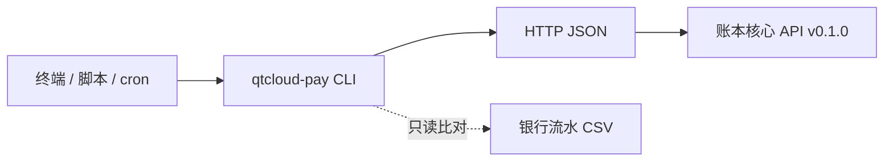

# 账本核心命令行工作台 v0.1.0（qtcloud-pay CLI）

命令行版管理人员操作台 —— 把 [provider.md](provider.md) 的操作入口变成终端命令，与 [studio.md](studio.md)（Flutter 桌面端）互为补充：GUI 适合人看，CLI 适合批量、定时、脚本化。

- 使用者：管理人员 / 运维 / 自动化脚本（负责人：shishiyuan）
- 配套文档：[provider.md](provider.md)（服务端路线图）、[studio.md](studio.md)（桌面端操作台）、[意图](../intention/index.md)、[领域模型](../insight/model.md)
- 使用方式：日常在终端执行「命令速查」；每日对账/验收走 `reconcile` / `milestone` 子命令；脚本与定时任务用 `--json` 输出 + 退出码判断

## 一、定位与边界

- **CLI 只做展示与参数组装，不承载账务逻辑**——结算、幂等、状态机全在服务端，与 studio 一致；CLI 出错提示引导到异常处置
- 与 studio 的分工：

| 场景 | studio（GUI） | CLI |
|------|--------------|-----|
| 日常人工操作 | ✔ 表单 + 页面 | ✔ 命令 |
| 批量/定时（每日对账、日报） | ✘ | ✔ 脚本 + cron |
| 机器可读输出 | ✘ | ✔ `--json` + 退出码 |
| 验收自检 | 手工打勾 | ✔ `milestone verify` 自动跑验收 |
| 金额输入 | AmountField（元转分） | `--amount 100.00`（元转分） |
| 幂等键 | IdempotencyField | `--receipt-no` / `--batch-no` / `--order-no` |

- 工程位置：`apps/qtcloud-pay/src/cli`（已初始化，对齐 studio 的工程约定）
- 命名：crate 名 `qtcloud-pay-cli`，命令 `qtcloud-pay`（对齐 `qtcloud_pay_studio` 命名）

## 二、安装与配置

```sh
cd apps/qtcloud-pay/src/cli
cargo build --release
# 生成 shell 补全（可选）
qtcloud-pay completions bash > ~/.local/share/bash-completion/completions/qtcloud-pay
```

配置来源（优先级从高到低）：`--server` 参数 > `QTPAY_SERVER_URL` 环境变量 > `~/.config/qtcloud-pay/config.toml`：

```toml
server_url = "http://localhost:8080"
```

全局选项（所有子命令可用）：

| 选项 | 说明 |
|------|------|
| `--server <URL>` | 账本核心 API 地址 |
| `--json` | JSON 输出（脚本用，金额仍为整数分） |
| `--quiet` | 只输出结果与错误，不输出进度 |
| `--no-color` | 禁用 ANSI 着色（非 TTY 自动禁用，兼容 `NO_COLOR`） |

## 三、命令速查（对齐 studio.md §2.1）

| 任务 | 命令 | 幂等键 | 核对要求 |
|------|------|--------|---------|
| 总览 | `qtcloud-pay status` | — | 今日待办（未对账/待结算） |
| 创建账户 | `qtcloud-pay accounts create --name <客户名>` | — | 每个客户一个账户 |
| 充值登记 | `qtcloud-pay recharges create <账户> --amount <元> --receipt-no <凭证号>` | 打款凭证号 | 余额增加，生成充值交易 |
| 发放优惠券 | `qtcloud-pay coupons issue <账户> --type rate --rate 0.9 [--scope 课程] [--expires-at 2026-09-30] --batch-no <批次号>` | 发放批次号 | 状态「已发放」，生成发券交易 |
| 发放代金券 | `qtcloud-pay vouchers issue <账户> --amount 50.00 [--scope 全场] [--expires-at 2026-12-31] --batch-no <批次号>` | 发放批次号 | 状态「已发放」，生成发券交易 |
| 下单结算 | `qtcloud-pay orders create --account <账户> --amount <元> --order-no <订单号> [--subject <商品>]` | 订单号 | 生成消费/核销交易，更新余额与券状态 |
| 查账户与余额 | `qtcloud-pay accounts get <账户>` | — | 余额 = 交易按方向求和 |
| 查交易流水 | `qtcloud-pay accounts transactions <账户> [--type 充值/消费/发券/核销]` | — | 任意交易可追溯（客诉可证） |
| 查优惠券 | `qtcloud-pay coupons list <账户>` | — | 发放可查 |
| 查代金券 | `qtcloud-pay vouchers list <账户>` | — | 发放可查 |
| 查订单与结算明细 | `qtcloud-pay orders get <订单>` | — | 逐笔抵扣记录对得上 |
| 账单导出 | `qtcloud-pay accounts statement <账户> -o statement.csv` | — | 对公核对用 |
| 每日对账 | `qtcloud-pay reconcile <账户>... --bank bank.csv` | — | 余额校验 + CSV 比对 |
| 参数配置 | `qtcloud-pay config billing-rule show` | — | 抵扣顺序可调、变更可登记 |
| 里程碑验收 | `qtcloud-pay milestone list / check / verify` | — | 验收清单打勾并记录日期 |



## 四、命令设计

### 4.1 账户与余额

```sh
qtcloud-pay accounts create --name "示例客户"            # POST /accounts
qtcloud-pay accounts get acc_01HX...                    # GET /accounts/{id}
qtcloud-pay accounts transactions acc_01HX... --json    # GET /accounts/{id}/transactions
qtcloud-pay accounts statement acc_01HX... -o stmt.csv  # GET /accounts/{id}/statement
```

输出（默认表格，金额按 MoneyText 约定：充值 `+` 绿、消费 `-` 红，整数分渲染）：

```
账户     acc_01HX...
余额     100.00 元（10000 分）

流水：3 笔
类型    金额(分)    方向    时间                   来源
充值    +10000      +      2026-08-02 10:00      打款凭证号 20260802-001
发券        0      -      2026-08-02 10:05      发放批次号 B-001
消费     -2000      -      2026-08-02 10:10      订单号 O-001
```

### 4.2 充值登记（对公打款入账）

```sh
qtcloud-pay recharges create acc_01HX... --amount 100.00 --receipt-no 20260802-001
```

- 金额：`--amount` 以元输入，本地转整数分提交（非负、最多两位小数校验，对应 AmountField）
- 幂等键：`--receipt-no` 必填（打款凭证号），对应 IdempotencyField
- 成功输出余额与新增交易；重复提交同一凭证号 → 业务错误退出码 1，提示参照异常处置（勿重复登记）

### 4.3 发券

```sh
# 折扣券：rate（如 9 折 = 0.9）
qtcloud-pay coupons issue acc_01HX... --type rate --rate 0.9 --scope 课程 \
  --expires-at 2026-09-30 --batch-no B-001
# 满减券：threshold + amount（满 100 减 20）
qtcloud-pay coupons issue acc_01HX... --type threshold --threshold 100.00 --amount 20.00 --batch-no B-002
# 代金券：固定面值
qtcloud-pay vouchers issue acc_01HX... --amount 50.00 --scope 数据服务 --expires-at 2026-12-31 --batch-no B-003

qtcloud-pay coupons list acc_01HX...    # 状态标签：已发放/已使用/已过期（StatusChip 对应物）
```

- 幂等键：`--batch-no` 必填（发放批次号）；发放成功后提示核对「状态已发放 + 存在发券交易」（不丢）

### 4.4 订单结算

```sh
qtcloud-pay orders create --account acc_01HX... --amount 100.00 --order-no O-001 --subject "课程A"
qtcloud-pay orders get O-001
```

结算明细输出对齐 SettleDetailPanel，逐项列出抵扣（优惠券 → 代金券 → 余额）与余额变化：

```
订单     O-001（课程A，100.00 元）
抵扣明细
  优惠券   满 100 减 20（B-002）      -20.00    → 已使用
  代金券   50 元代金券（B-003）        -50.00    → 已使用
  余额     补足                        -30.00
  合计                                 -100.00
余额变化  100.00 → 70.00 元
```

### 4.5 对账（M4）

```sh
# 余额校验：任意账户余额 = 交易按方向求和（一致性校验）
qtcloud-pay reconcile acc_01HX...
# 多账户校验 + 对公打款核对（充值登记 vs 银行流水 CSV）
qtcloud-pay reconcile acc_01HX... acc_01HY... --bank bank_20260802.csv
```

差异行输出（对应 ReconcileDiffTable），附跳转流水提示：

```
账户           余额(分)   交易求和(分)   差异
acc_01HX...    10000      10000         0      ✔
acc_01HY...    5000       4800          +200   ✘ → qtcloud-pay accounts transactions acc_01HY...

银行流水比对：充值登记 3 笔 vs 银行流水 3 笔，0 差异（对公核对通过）
```

- `--bank <file>`：银行流水 CSV（默认列 `date,amount,remark`，可用 `--bank-cols` 配置列名映射）
- 只读校验：CLI 不修改账本，差异登记到异常处置表后人工回溯
- 适合 cron 定时执行，输出到日志/通知（`--json` 供程序消费）

### 4.6 参数配置（对应 §三）

```sh
qtcloud-pay config billing-rule show   # 展示默认抵扣顺序与变更登记引导
qtcloud-pay config billing-rule set --priority "coupon:voucher:balance"   # 预留：服务端参数 API 就绪后启用
```

- v0.1.0 服务端无参数 API，`show` 输出默认顺序（满足条件的优惠券 → 代金券抵现 → 余额补足）并引导到参数变更登记表；`set` 为占位命令，服务端就绪后启用，不改代码可调

### 4.7 里程碑验收（对应 §四）

```sh
qtcloud-pay milestone list     # M1–M5 状态与验收结论（读本地登记，输出对齐 §一 仪表盘）
qtcloud-pay milestone check M1 --note "余额校验通过"    # 打勾并记录当天日期
qtcloud-pay milestone verify M1   # 自动执行 M1 验收：创建账户 → 充值 → 重复登记幂等拦截 → 余额=交易求和
```

- `verify` 会写入测试数据，提示在测试环境执行；`check` 只写本地登记文件（`~/.config/qtcloud-pay/state.toml`），不修改服务端

## 五、输出与退出码约定

- **默认**：表格输出（tabled），金额/状态着色；`--json` 输出机器可读（金额保持整数分）；statement 导出 CSV（对齐 M4 账单导出）
- **退出码**（脚本判断依据，对应异常处置分类）：

| 码 | 含义 | 示例 |
|----|------|------|
| 0 | 成功 | — |
| 1 | 业务错误 | 幂等键冲突、过期券被使用、余额对不上 |
| 2 | 用法错误 | 缺少必填参数、金额格式非法 |
| 3 | 网络/服务端错误 | 连接失败、5xx |

- 错误提示附处置引导（对齐 studio.md §五），如：`✘ 幂等冲突（receipt_no 已入账）：确认凭证号是否已入账，勿重复登记`

## 六、技术方案

| 决策 | 选择 | 理由 |
|------|------|------|
| 语言 | Rust（edition 2021） | 单二进制、启动快、依赖少，适合运维/脚本场景 |
| 命令解析 | clap 4（derive）+ clap_complete | 子命令树、校验、帮助与 shell 补全 |
| HTTP | reqwest + tokio | 异步生态成熟，JSON 编解码内建 |
| 序列化 | serde / serde_json | 模型与 API JSON 一一对应 |
| 输出 | tabled（表格）/ serde_json / csv | 人读表格、机器读 JSON、对账读 CSV |
| 金额 | i64 整数分，元↔分转换集中 `money.rs` | 与服务端一致，无浮点误差 |
| 幂等键 | uuid（与 studio 依赖一致）生成建议值 + 必填校验 | 不重 |
| 错误 | thiserror（模型/API 层）+ anyhow（命令层）+ 退出码 | 异常可脚本化处置 |
| 配置 | `QTPAY_SERVER_URL` 环境变量 + config.toml | 环境注入与本地配置并存 |
| 质量 | 单元测试（金额、CSV 比对、退出码）+ mock 集成测试 | 延续 provider >95% 的标准，核心路径必须有测试 |

## 七、代码结构

```
apps/qtcloud-pay/src/cli/
├── Cargo.toml
├── src/
│   ├── main.rs            ← clap 命令树入口、退出码映射
│   ├── config.rs          ← 配置加载（参数 > 环境变量 > config.toml）
│   ├── money.rs           ← 元↔分转换、MoneyText 格式化（+绿/-红）
│   ├── status.rs          ← 状态标签着色（StatusChip 对应物）
│   ├── output.rs          ← 表格/JSON/CSV 渲染
│   ├── api/               ← HTTP 客户端（对齐 lib/services/pay_api.dart）
│   │   ├── mod.rs         ← Client 构造（base URL、超时、错误归一化）
│   │   ├── accounts.rs    ← 账户/流水/账单端点
│   │   ├── coupons.rs     ← 券/代金券端点
│   │   ├── orders.rs      ← 订单端点
│   │   └── error.rs       ← 业务错误（幂等冲突、过期券）→ 退出码 1
│   ├── models/            ← 领域模型（serde Deserialize，与模型.md一一对应）
│   │   ├── account.rs / transaction.rs / coupon.rs
│   │   ├── voucher.rs / order.rs / billing_rule.rs
│   └── commands/          ← 子命令实现（解析 → 调 API → 输出）
│       ├── accounts.rs / recharges.rs / coupons.rs / vouchers.rs
│       ├── orders.rs / reconcile.rs / config.rs / milestone.rs
└── tests/
    ├── money.rs           ← 元↔分、格式化、非法金额
    └── reconcile_csv.rs   ← 余额校验、银行流水比对
```

## 八、里程碑对应与验收

CLI 本身是 M1–M4 的验收工具：`milestone verify` 自动执行 provider.md 的验收动作。

| 里程碑 | CLI 验收动作 | 自动化点 |
|--------|-------------|---------|
| M1 账户与账本 | `milestone verify M1` | 创建账户 → 充值 → 重复登记幂等拦截 → 余额 = 交易求和 |
| M2 优惠券与代金券 | `coupons/vouchers issue + list` | 发放可查、发券交易存在（不丢）、过期不可用 |
| M3 订单与计费规则 | `orders create/get` | 全链路结算明细逐项核对（不错） |
| M4 对账与可查 | `reconcile <账户>... --bank` | 余额一致性 + CSV 比对一键跑通 |

## 九、异常处置映射（对齐 studio.md §五）

| 异常 | CLI 现象 | 处置 |
|------|---------|------|
| 重复登记 | 退出码 1，提示幂等冲突 | 确认凭证号是否已入账，勿重复登记 |
| 过期券被使用 | 退出码 1，结算报错 | 查 `expiresAt` 与状态机流转 |
| 余额对不上 | `reconcile` 输出差异行 | 导出 statement 逐笔核对，登记异常并回溯交易 |
| 发券丢失 | 流水无发券记录 | 检查幂等键唯一约束，补登记同批次号 |
| 抵扣顺序异常 | 结算明细顺序异常 | 检查 `BillingRule.priority` 配置（§4.6） |

## 十、v0.2.0 交接参考

手动登记 → 系统化记录 → 自动化执行：v0.2.0 支付回调自动入账后，CLI 角色从「登记」变为「核对」。

| 能力 | CLI 变化 |
|------|---------|
| 充值登记 | `recharges create` 保留（补登记/差错处理），日常充值转为 `reconcile` 核对 |
| 支付通道 | 新增 `qtcloud-pay payments` 子命令封装 provider HTTP API（`POST /pay`、`GET /query/{order_id}`、`POST /refund`），可选排期 |
| 模型 | 不变，变的只是交易来源——CLI 命令树不变，新增数据来源展示 |
