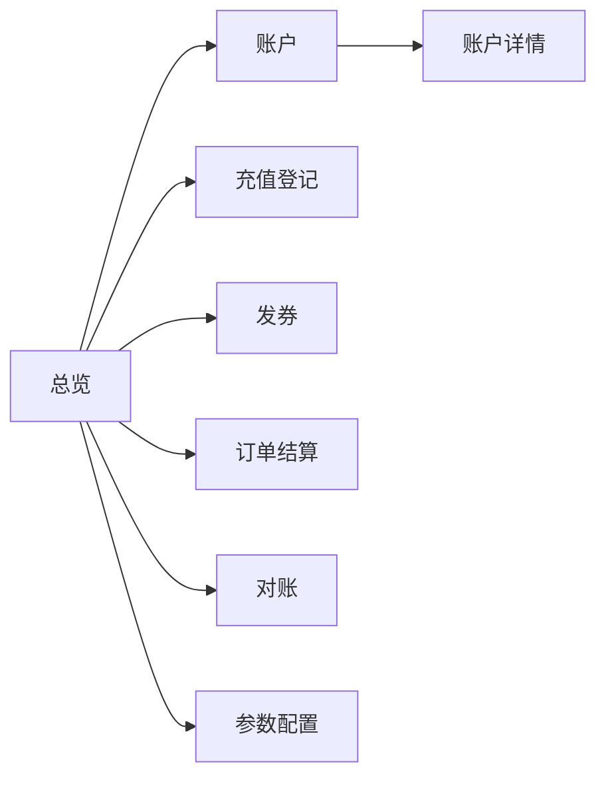

# 账本核心工作台 v0.1.0

管理人员操作台 — 把 [provider.md](provider.md) 的路线图表变成日常可执行的操作：进度跟踪、业务操作、参数配置、验收确认。

- 使用者：管理人员（负责人：shishiyuan）
- 配套文档：[provider.md](provider.md)（服务端路线图）、[意图](../../intention/index.md)、[领域模型](../../insight/model.md)
- 使用方式：日常按「系统操作台」执行；里程碑完成后在「验收清单」打勾并记录日期；业务参数调整走「参数配置台」并登记

## 一、总览仪表盘（对「里程碑」表）

| # | 里程碑 | 优先级 | 状态 | 验收结果（日期 + 结论） | 备注 |
|---|--------|--------|------|------------------------|------|
| M1 | 账户与账本 | P0 | 🚧 进行中 | | |
| M2 | 优惠券与代金券 | P1 | ⬜ 未开始 | | |
| M3 | 订单与计费规则 | P1 | ⬜ 未开始 | | |
| M4 | 对账与可查 | P1 | ⬜ 未开始 | | |
| M5 | 支付通道对接（v0.2.0） | P2 | ⬜ 未开始 | | 依赖 M1–M4 完成 |

状态图例：⬜ 未开始 / 🚧 进行中 / ✅ 已完成

## 二、系统操作台（日常任务）

v0.1.0 是无界面的 API 服务，管理人员的「操作」即调用以下入口。所有操作都要满足可靠性四要素：**不丢、不重、不错、可查**。

### 2.1 操作入口速查

| 任务 | 入口 | 幂等键 | 核对要求 |
|------|------|--------|---------|
| 创建账户 | `POST /accounts` | — | 每个客户一个账户 |
| 充值登记 | `POST /accounts/{id}/recharges` | 打款凭证号 | 余额增加，生成充值交易 |
| 发放优惠券 | `POST /accounts/{id}/coupons` | 发放批次号 | 状态「已发放」，生成发券交易 |
| 发放代金券 | `POST /accounts/{id}/vouchers` | 发放批次号 | 状态「已发放」，生成发券交易 |
| 下单结算 | `POST /orders` | 订单号 | 生成消费/核销交易，更新余额与券状态 |
| 查账户与余额 | `GET /accounts/{id}` | — | 余额 = 交易按方向求和 |
| 查交易流水 | `GET /accounts/{id}/transactions` | — | 任意交易可追溯（客诉可证） |
| 查优惠券 | `GET /accounts/{id}/coupons` | — | 发放可查 |
| 查代金券 | `GET /accounts/{id}/vouchers` | — | 发放可查 |
| 查订单与结算明细 | `GET /orders/{id}` | — | 逐笔抵扣记录对得上 |
| 账单导出 | `GET /accounts/{id}/statement` | — | 对公核对用 |

### 2.2 充值登记流程（对公打款入账）

1. 客户对公打款 → 拿到**打款凭证号**
2. 登记：`POST /accounts/{id}/recharges`，幂等键 = 打款凭证号
3. 核对：账户余额增加、生成一笔充值交易
4. 若重复提交同一凭证号，唯一约束拦截（**不重**）；余额与交易同事务更新（**不错**）
5. 金额用**整数分**提交（如 100.00 元 = 10000 分）

### 2.3 发券流程

1. 确定发放对象（账户）与券参数（见参数配置台）
2. 发放：`POST /accounts/{id}/coupons` 或 `/vouchers`，幂等键 = 发放批次号
3. 核对：券状态「已发放」，同时存在一笔发券交易（**不丢**）
4. 发重复批次会幂等拦截；有效期过后状态流转「已过期」，不可再使用

### 2.4 消费结算流程

1. 客户购买付费服务 → 管理人员下单：`POST /orders`
2. 系统按计费规则自动结算：满足条件的优惠券 → 代金券抵现 → 余额补足
3. 核对：`GET /orders/{id}` 查看逐项抵扣明细；账本逐笔对得上（**不错**）
4. 优惠券核销、代金券抵现、余额扣减在同一笔消费交易内完成

### 2.5 每日对账

1. 导出各账户账单：`GET /accounts/{id}/statement`
2. 余额校验：任意账户余额 = 该账户交易求和（充值 +、余额支付 −）
3. 对公核对：充值登记 vs 银行流水（手动导入 CSV 比对）
4. 对不上的记录到「异常处置」登记表

## 三、参数配置台（管理人员可调）

### 3.1 计费抵扣顺序（BillingRule.priority）

v0.1.0 默认顺序，由 `priority` 配置，**不改代码可调**：

1. 满足条件的优惠券（满减先减、折扣按比例）
2. 代金券抵现
3. 余额补足

### 3.2 优惠券参数（Coupon）

| 参数 | 说明 | 示例 |
|------|------|------|
| 类型 | 折扣券 `rate` / 满减券 `threshold` + `amount` | 9 折；满 100 减 20 |
| `scope` | 全场 / 指定业务（云服务、课程、数据服务）/ 指定商品 | 课程 |
| `expiresAt` | 有效期，过期不可用 | 2026-09-30 |

### 3.3 代金券参数（Voucher）

| 参数 | 说明 | 示例 |
|------|------|------|
| `amount` | 固定面值，等价现金，结算直接抵现 | 50 元 |
| `scope` | 全场 / 指定业务 / 指定商品 | 数据服务 |
| `expiresAt` | 有效期 | 2026-12-31 |

### 3.4 参数变更登记表

| 日期 | 变更项 | 旧值 | 新值 | 申请人 | 审批 |
|------|--------|------|------|--------|------|
| | | | | | |

## 四、里程碑验收清单（对「验收」列）

### M1 账户与账本

- [ ] `POST /accounts` 可创建账户
- [ ] 打款登记后余额正确（不错）
- [ ] 重复登记不生效两次（不重）
- [ ] 余额与流水可查（可查）
- [ ] 幂等、事务路径有测试覆盖

验收日期：＿＿＿＿　结论：＿＿＿＿

### M2 优惠券与代金券

- [ ] 优惠券/代金券发放可查
- [ ] 发券生成发券交易（不丢）
- [ ] 过期不可用
- [ ] 状态机（已发放 → 已使用 / 已过期）测试覆盖

验收日期：＿＿＿＿　结论：＿＿＿＿

### M3 订单与计费规则

- [ ] 一笔消费全链路结算（优惠券 → 代金券 → 余额）
- [ ] 账本逐笔对得上（不错）
- [ ] 抵扣顺序由 `BillingRule.priority` 配置，可调

验收日期：＿＿＿＿　结论：＿＿＿＿

### M4 对账与可查

- [ ] 余额 = 交易求和（一致性校验）
- [ ] 任意交易可追溯
- [ ] 对公打款核对（CSV 比对）流程跑通
- [ ] 账单导出可用

验收日期：＿＿＿＿　结论：＿＿＿＿

## 五、异常处置

| 异常 | 现象 | 处置 |
|------|------|------|
| 重复登记 | 幂等键冲突报错 | 确认该凭证号是否已入账，勿重复登记 |
| 过期券被使用 | 结算时报错 | 检查 `expiresAt` 与状态机流转 |
| 余额对不上 | 余额 ≠ 交易求和 | 导出 statement 逐笔核对，登记异常并回溯交易 |
| 发券丢失 | 流水无发券记录 | 检查幂等键唯一约束，补登记同批次号 |
| 抵扣顺序不符合预期 | 结算明细顺序异常 | 检查 `BillingRule.priority` 配置 |

## 六、Flutter 客户端（qtcloud_pay_studio）

管理人员的图形化工作台：桌面客户端（Windows/macOS），把 §二 的 API 操作包装成页面。服务端 v0.1.0 仅提供 API，客户端只做展示与表单，不承载账务逻辑——结算、幂等、状态机全在服务端，客户端出错提示引导到 §五 异常处置。

- 工程位置：`apps/qtcloud-pay/src/studio`（已初始化）
- 命名：`qtcloud_pay_studio`（对齐 qtcloud_learn_studio 的工程约定）
- 依赖：http / provider / uuid（与 qtcloud_learn_studio 一致）
- 代码结构：`lib/screens/`（页面）、`lib/widgets/`（复用组件）、`lib/models/`（领域模型）、`lib/services/`（API 客户端）

### 6.1 导航与页面

桌面端左侧导航，各页面直接对应 §2.1 操作入口：

| 页面 | 文件 | 主要功能 | 对应入口 |
|------|------|---------|---------|
| 总览 | `dashboard_screen.dart` | 里程碑状态（M1–M5）、今日待办（未对账/待结算）、快捷入口 | — |
| 账户 | `accounts_screen.dart` | 账户列表、创建账户 | `POST /accounts` |
| 账户详情 | `account_detail_screen.dart` | 余额、交易流水、券列表 | `GET /accounts/{id}`、`/transactions`、`/coupons`、`/vouchers` |
| 充值登记 | `recharge_screen.dart` | 对公打款入账 | `POST /accounts/{id}/recharges` |
| 发券 | `coupon_screen.dart` | 优惠券/代金券发放与查询 | `POST /accounts/{id}/coupons`、`/vouchers` |
| 订单结算 | `order_screen.dart` | 下单、结算明细 | `POST /orders`、`GET /orders/{id}` |
| 对账 | `reconcile_screen.dart` | 余额校验、CSV 比对 | `GET /accounts/{id}/statement` |
| 参数配置 | `settings_screen.dart` | 抵扣顺序、券模板、变更登记 | —（调 §三 参数） |

### 6.2 关键页面说明

- **充值登记页**：表单含账户（AccountPicker）、金额（AmountField，元转分）、打款凭证号（IdempotencyField，幂等键）；提交后展示余额与新增交易；重复凭证号提交报错，提示参照 §五 处置
- **发券页**：选择类型（优惠券/代金券）后按类型展示参数——折扣券 `rate`、满减券 `threshold`+`amount`、代金券面值，以及 `scope`、`expiresAt`；发放批次号作幂等键；列表展示券状态（StatusChip）
- **订单结算页**：表单含客户、订单金额；提交后展示 SettleDetailPanel 逐项抵扣（优惠券 → 代金券 → 余额），并更新券状态与余额
- **对账页**：一键导出各账户 statement；导入银行流水 CSV；展示 ReconcileDiffTable 差异行（余额 vs 交易求和）；异常引导到 §五

### 6.3 复用组件（lib/widgets/）

| 组件 | 用途 | 关键行为 |
|------|------|---------|
| `MoneyText` | 金额展示（分 → 元） | 充值 + 绿 / 消费 − 红；整数分渲染，无浮点误差 |
| `StatusChip` | 状态标签 | 券：已发放/已使用/已过期；订单：已结算/待结算（对齐 qtcloud_learn_studio） |
| `AccountPicker` | 客户/账户选择 | 搜索 + 返回账户 id |
| `IdempotencyField` | 幂等键输入 | 必填 + 唯一性提示（凭证号/批次号/订单号） |
| `AmountField` | 金额输入（元） | 非负、两位小数校验，提交转分 |
| `TransactionList` | 交易流水 | 类型/金额/时间/来源，任意交易可追溯 |
| `SettleDetailPanel` | 结算明细 | 逐项列出抵扣与余额变化 |
| `ReconcileDiffTable` | 对账差异表 | 差异行定位 + 跳转流水 |
| `MilestoneCard` | 里程碑状态卡 | M1–M5 状态（⬜/🚧/✅）与验收结论（读 §一） |

### 6.4 数据与服务层

- `lib/models/`：Account / Transaction / Coupon / Voucher / Order / BillingRule，与[领域模型](../../insight/model.md)一一对应
- `lib/services/pay_api.dart`：封装 §2.1 全部端点；金额统一 `AmountField` 转分、`MoneyText` 转元
- 客户端不做账务计算，展示的数据均来自服务端校验后的结果

## 七、v0.2.0 交接参考（对「现状」表）

通道能力在 v0.0.1（2026-07-11）已具备，账本跑通后作为交易来源接入，**模型不变，变的只是交易来源**：

| 已具备能力 | 说明 | 交接动作 |
|------------|------|---------|
| Provider 接口 | `Name` / `Pay` / `Query` / `Refund` | 复用 provider 包 |
| 微信 JSAPI | 下单、查询、退款、通知解析（gopay v3） | 回调自动生成充值交易 |
| 支付宝网页支付 | 下单、查询、退款、通知验签（gopay） | 回调自动生成充值交易 |
| HTTP API | `POST /pay`、`GET /query/{order_id}`、`POST /refund` | 逐步验证后启用 |

阶段演进：手动登记（本工作台当前操作）→ 系统化记录 → 自动化执行（v0.2.0 起）。
